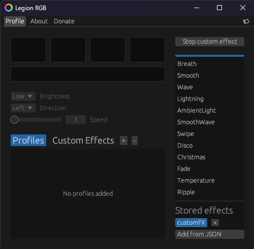

# Legion RGB Control <!-- omit in toc -->

<div align="center">


</div>

## Download

**⚠️ Use at your own risk, the developer is not responsible for any damages that may arise as a result of using this program.**

## Available effects

**All stock effects:** Static, Breath, Smooth, LeftWave, RightWave.

**Custom effects:**

- **Lightning:** Adds a little _spark_.
- **AmbientLight:** Reacts to content on your screen.
- **Smooth(Left/Right)Wave:** An implementation of the classic wave effect.
- **(Left/Right)Swipe:** Transitions the selected colors from side to side, useful for custom waves.
- **Disco:** A portable dance floor!
- **Christmas:** Even keyboards can get festive.
- **Fade:** Turns off the keyboard lights after a period of inactivity.
- **Temperature:** Displays a gradient based on the current CPU temperature. (Linux only)
- Load custom effect with JSON file

#### At a glance

- You can load JSON file directly. using a `json` file with the following format:

```json
{
  "effect_steps": [
    {"rgb_array": [0, 0, 0, 0, 100, 0, 0, 0, 0, 0, 0, 0], "step_type": "Set", "brightness": 1, "steps": 100, "delay_between_steps": 100, "sleep": 100},
    {"rgb_array": [0, 100, 0, 0, 0, 200, 0, 0, 200, 200, 0, 0], "step_type": "Transition", "brightness": 1, "steps": 100, "delay_between_steps": 100, "sleep": 100}
  ],
  "should_loop": true
}
```

#### File sections

- **effect_steps:** Contains the different _"steps"_ the effect will go through.
  - **rgb_array:** An array describing the colours to use in the `[r,g,b,r,g,b...]` format.
  - **step_type:** The type of step to use. You may instantly swap the colours with `Set` or smoothly transition to them with `Transition`.
  - **brightness:** The brightness of the step, can be `1` (low) or `2` (high).
  - **steps:** To smoothly transition between colours, the keyboard LEDs are set at small intervals until they reach the desired color. This controls the number of them.
  - **delay_between_steps:** How much time to wait between each interval (In ms).
  - **sleep:** The time to wait before going to the next `effect_step` (In ms).
- **should_loop:** Whether the effect should start again once it reaches the last step.

<!-- Follow [this guide](https://gtk-rs.org/gtk4-rs/stable/latest/book/installation_windows.html#pkg-config) but build GTK3 instead of GTK4. -->

### Using `cargo-make`

Works on both Windows and Linux.

- Install `cargo-make`

```sh
cargo install cargo-make
```

- Clone the repository

```sh
git https://github.com/RevinSitorus/L5P-Keyboard-RGB-Modifed.git
```

- Build the project

```sh
cd L5P-Keyboard-RGB-modified/
cargo make build-release
```

### Building manually

- Download and bootstrap [VCPKG](https://github.com/Microsoft/vcpkg#getting-started)
- You'll need to set an environment variable called `VCPKG_ROOT` pointing to the directory where you downloaded and bootstrapped VCPKG.

- Download the VCPKG dependencies

Windows:

```cmd
vcpkg update && vcpkg install libvpx:x64-windows-static libyuv:x64-windows-static
```

Linux:

```sh
vcpkg update && vcpkg install libvpx libyuv
```

- Clone the repository

```sh
git clone https://github.com/4JX/L5P-Keyboard-RGB.git
```

- Build the project

```sh
cd L5P-Keyboard-RGB/
cargo build --release
```
